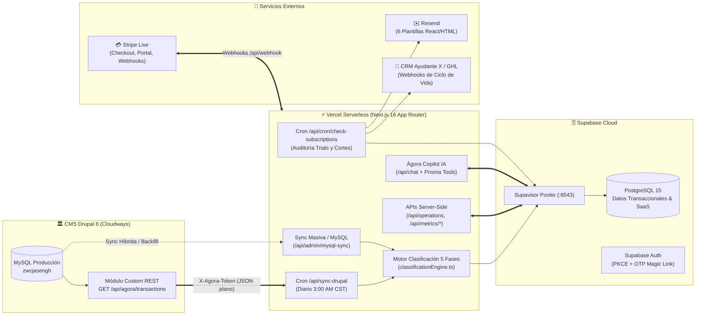
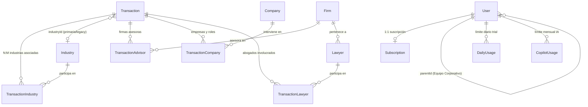

# 🏗️ 01. Arquitectura de la Solución — Ágora Plus SaaS

> **Versión:** 5.11.0  
> **Última actualización:** 28 de octubre de 2026  
> **Dominio Producción:** [https://www.agora-lexlatin.com](https://www.agora-lexlatin.com)  
> **Repositorio:** `github.com/mov1datc1/agora_saas_plus` (`dev` → `main`)

---

## 1. Visión General de la Arquitectura

**Ágora Plus** es la plataforma SaaS B2B de inteligencia transaccional del mercado legal latinoamericano para **LexLatin**. Extrae, filtra, clasifica y normaliza las operaciones corporativas cargadas por el equipo de Data Entry en el CMS Drupal 8 de LexLatin y las sirve mediante una arquitectura Serverless de alta velocidad en **Next.js + Supabase PostgreSQL + Prisma + Vercel**.

---

## 2. Stack Tecnológico

| Capa | Tecnología | Versión / Configuración |
|---|---|---|
| **Framework Full-Stack** | Next.js (App Router + Server Actions) | `16.2.9` |
| **Librería UI** | React + Tailwind CSS v4 + Framer Motion | `19.2.4` |
| **ORM & Pooler** | Prisma ORM + `@prisma/adapter-pg` (`pg`) | `7.8.0` (Max 2 conn/instancia hacia puerto `6543`) |
| **Base de Datos** | PostgreSQL en Supabase | `15.x` |
| **Autenticación** | Supabase Auth (`@supabase/ssr`) | Sesiones vía cookies + soporte PKCE y OTP |
| **Visualización** | Recharts + `react-simple-maps` + `d3-scale` | Mapas Mercator interactivos + gráficos dinámicos |
| **Copilot IA** | Vercel AI SDK + OpenAI `gpt-4o-mini` | Tool-Calling determinístico sobre Prisma |
| **Pagos y Facturación** | Stripe Live Mode (`acct_1NvmaWA8zDaMc9Ma`) | Checkout, Billing Portal y Webhook `/api/webhook` |
| **Emails Transaccionales** | Resend (`soporte@agora-lexlatin.com`) | 6 plantillas dinámicas administrables en BD |
| **Fuente de Datos** | Módulo Drupal Custom `agora_api` | `GET https://lexlatin.com/api/agora/transactions` |

---

## 3. Modelo de Datos Relacional (Prisma Schema)

El esquema (`prisma/schema.prisma`) modela tanto el **Data Warehouse Transaccional** como el **Core SaaS B2B**:

### 3.1. Tablas Principales del Universo Transaccional
* **`Transaction`**: Núcleo de cada operación (`id = "drupal-{nid}"`, `title`, `type` [`M&A` | `Financiamientos` | `Emisiones` | `Operación General`], `value` en USD, `valueString`, `status`, `country` separado por comas para operaciones Crossborder, `isPublished`, `practiceArea`, `typeOverride`, `dateAnnounced`, `dateClosed`, `link`, `excerpt` HTML sanitizado).
* **`Industry` y `TransactionIndustry` (Soporte Multi-Industria N:M)**:
  * Cada operación puede tener **múltiples industrias asociadas** cargadas en Drupal (por ejemplo: *Gas Natural*, *Petróleo* y *Transporte y logística*).
  * La tabla puente `TransactionIndustry` (`@@unique([transactionId, industryId])`) almacena todas las industrias asociadas a la operación, mientras que `Transaction.industryId` conserva la primera industria por compatibilidad.
* **`Firm` y `TransactionAdvisor`**: Firmas legales asesoras (incluyendo sede, ej. `"Cuatrecasas - Santiago"`).
* **`Company` y `TransactionCompany`**: Empresas participantes con su rol normalizado (`Comprador`, `Vendedor`, `Target`, `Emisor`, `Prestatario`, `Prestamista`, `Líder Sindicato Bancos`, etc.).
* **`Lawyer` y `TransactionLawyer`**: Abogados participantes en la transacción.

### 3.2. Tablas del Core SaaS, Seguridad y Auditoría
* **`User`**: Usuarios con roles (`USER`, `ADMIN`, `SUPERADMIN`), tipo de cuenta (`INDIVIDUAL`, `CORPORATE`, `CORPORATE_3`), jerarquía corporativa (`parentId`), control de acceso (`isActive`), y auditoría de sesión (`firstLoginAt`, `lastLoginAt`).
* **`Subscription`**: Estado de suscripción sincronizado con Stripe (`TRIAL`, `ACTIVE`, `PAST_DUE`, `CANCELED`, `INCOMPLETE`), `trialEndsAt`, `trialReminderSentAt`, `currentPeriodEnd`.
* **`EmailTemplate`**: Las 6 plantillas HTML editables desde `/dashboard/admin/smtp` (`WELCOME`, `REMINDER_TRIAL`, `TRIAL_CANCELLED`, `PAYMENT_SUCCESS`, `DUNNING`, `UPCOMING_RENEWAL`).
* **`SystemConfig`**: Configuración global en vivo (restricciones de trial, visibilidad de métricas/rankings, modo mantenimiento, webhooks de CRM y etiquetas GHL).
* **`CronLog` y `SyncJob`**: Bitácora de ejecuciones automáticas y manuales del ETL y auditoría de suscripciones.

---

## 4. Módulos de la Aplicación y APIs Server-Side

1. **Explorador de Operaciones (`/dashboard/operations` → `GET /api/operations`)**:
   * Filtrado server-side combinado por **País(es)**, **Rango de Fechas** (usando fecha efectiva `COALESCE(dateClosed, dateAnnounced)`), **Valor Económico (USD)**, **Firma de Abogados (con sede)**, **Industria** (busca en todas las industrias asociadas vía `TransactionIndustry`), **Abogado**, **Tipo de Operación** (`M&A`, `Financiamientos`, `Emisiones`) y **Búsqueda de texto libre**.
   * Panel lateral de resumen con KPIs en vivo (Total operaciones, Valor Agregado USD, Ticket Promedio USD).
   * Drawer de detalle de transacción (`GET /api/transactions/[id]`) y exportación nativa a **PDF** y **Excel**.
2. **Clasificación de Firmas (`/dashboard/metrics/firms` → `GET /api/metrics/firms`)**:
   * Ranking centrado en país (por defecto México, con priorización de Latinoamérica) ordenable por número de operaciones o monto público acumulado (USD), desglosando operaciones públicas vs. confidenciales.
3. **Jurisdicciones e Industrias — Storytelling en 3 Niveles (`/dashboard/metrics/countries` → `GET /api/metrics/countries`)**:
   * **Nivel 1:** Mapa interactivo Mercator con volumen y monto acumulado por jurisdicción.
   * **Nivel 2:** Desglose de industrias activas en el país seleccionado (contabilizando todas las industrias asociadas en `TransactionIndustry`) + gráfico Donut de participación sectorial.
   * **Nivel 3:** Ranking de firmas líderes dentro del binomio `[Industria] × [País]`.
4. **Ágora Copilot (`/dashboard/copilot` → `POST /api/chat`)**:
   * Asistente analítico impulsado por IA con herramientas conectadas directamente a Prisma (`getTopFirms`, `getTopIndustries`, `getTopCountries`, `searchTransactions`, `getMarketSummary`).
5. **Gatekeeper de Suscripciones y Candado Anti-Abuso**:
   * Validación central en `src/app/dashboard/layout.tsx`: bloquea inmediatamente cuentas con `isActive === false`, `status === 'CANCELED'` o `TRIAL` vencido, redirigiendo a `/deactivated`.
   * **Candado de 1 Prueba por Correo:** Si un email ya tuvo prueba previa, `/register` y `/api/public-checkout` omiten los 15 días de trial y dirigen al pago inmediato del plan oficial.
