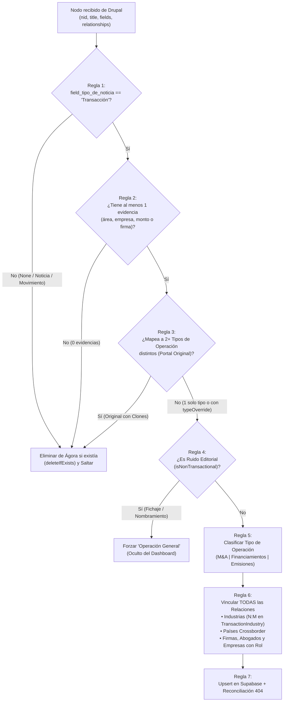

# ⚙️ 03. Reglas de Negocio y Pipeline ETL — Ágora Plus

> **Archivos Principales:**
> - Sincronización API Drupal (Cron y Manual): [`src/app/api/sync-drupal/route.ts`](../src/app/api/sync-drupal/route.ts)
> - Sincronización MySQL Directa (Admin): [`src/app/api/admin/mysql-sync/route.ts`](../src/app/api/admin/mysql-sync/route.ts)
> - Motor de Clasificación y Filtro de Ruido: [`src/lib/classificationEngine.ts`](../src/lib/classificationEngine.ts)
> - Backfill Multi-Industria: [`scripts/backfill-industries.js`](../scripts/backfill-industries.js)

---

## 1. Resumen del Pipeline ETL

Cada vez que Ágora Plus sincroniza operaciones desde Drupal (ya sea mediante el Cron automático diario a las 3:00 AM CST en `/api/sync-drupal`, desde el botón de sincronización en el panel Admin, o mediante scripts de backfill), cada nodo pasa por **7 reglas estrictas de validación, clasificación y normalización** diseñadas junto con el equipo de Data Entry de LexLatin (Ángela Castillo y Daniela Bernal).

---

## 2. Las 7 Reglas de Negocio en Detalle

### Regla 1: Filtro Primario por "Tipo de Noticia" (`field_tipo_de_noticia`)
En el formulario de Drupal existen las opciones: `"- None -"`, `"Transacción"`, `"Acción judicial o extrajudicial"`, `"Movimiento"`, `"Eventos e iniciativas"`.
* **Regla:** Únicamente se importan nodos cuyo `field_tipo_de_noticia` sea explícitamente **`"Transacción"`**.
* **Efecto destructivo en re-sync:** Si un nodo previamente sincronizado es cambiado en Drupal a `"- None -"` o `"Movimiento"`, el ETL ejecuta `deleteIfExists(transactionId)` y lo elimina de Ágora junto con sus relaciones.

---

### Regla 2: Guardrail de Evidencia Cero (Zero-Evidence Guardrail)
En ocasiones se marcan por error notas editoriales como `"Transacción"` en Drupal sin llenar datos transaccionales.
* **Regla:** Todo caso debe tener al menos **UNO** de los siguientes 4 elementos:
  1. `practice_areas.length > 0`
  2. `companies.length > 0`
  3. `monetary.total_usd > 0`
  4. `firms.length > 0`
* Si los 4 están vacíos, el registro se descarta (y se elimina si existía en BD).

---

### Regla 3: Metodología de Clones de Data Entry (Filtro "Portal Original" y Clones No Publicados)
Cuando una operación real involucra múltiples naturalezas jurídicas o transacciones paralelas (por ejemplo, una compra apalancada que es **M&A + Financiamiento**, o un reporte consolidado con varias ventas como el caso *Urban, Greystar Brasil y Genetica Bioscience* `node/136899`), la metodología oficial del equipo de Data Entry en Drupal es:
1. Publicar en el portal de LexLatin una nota matriz u original que agrupa el evento editorial. A menudo esta nota matriz tiene `field_tipo_de_noticia` como `- None -` o tiene marcadas múltiples áreas de práctica de distintas familias.
2. Crear en Drupal **clones no publicados** (`field_caso_no_publicado: true`, ej. `node/136907`, `node/136908`, `node/136909`), uno por cada operación individual, con sus propios montos, partes y abogados asesores asignados específicamente a ese negocio.
* **Regla de Filtrado y Purga del Original:**
  * Si el post matriz está marcado como `- None -`, la **Regla 1** lo descarta y purga de inmediato.
  * Si el post matriz fue marcado como `"Transacción"` pero mapea a **2 o más tipos de operación distintos** (`allMappedTypes.length >= 2`, ej. `['M&A', 'Financiamientos']`) y no tiene `typeOverride`, la **Regla 3** lo identifica como el **Portal Original** → **se salta y se purga de Ágora**, evitando conteos duplicados.
* **Ingesta de Clones Canónicos:**
  * Los clones no publicados ingresan a Ágora con `isPublished: false`, conservan su tipo único específico (`M&A`, `Financiamientos` o `Emisiones`) y son desplegados con normalidad en el módulo de Operaciones para total fidelidad del universo transaccional.
* **Excepción de Homogeneidad:** Si un nodo tiene 2 áreas de práctica que mapean al **mismo** tipo de operación (ej. `"Corporativo - Adquisiciones"` + `"Corporativo - Fusiones"`, ambas `M&A`), **NO** hay conflicto (`uniqueTypes.length === 1`) y la operación se conserva íntegra.

---

### Regla 4: Filtro de Ruido Editorial (`isNonTransactional`)
Algunas notas de nombramientos de socios o aperturas de áreas traen etiquetada el área `"Corporativo - Adquisiciones"`.
* **Regla:** El motor [`classificationEngine.ts`](../src/lib/classificationEngine.ts) evalúa el título y el cuerpo buscando señales editoriales (`nombramiento`, `fichaje`, `nuevo socio`, `refuerza práctica`, `promueve a`, etc.). Si detecta ruido editorial sin evidencia de transacción financiera, clasifica el registro como `"Operación General"`, el cual queda excluido de todos los dashboards y conteos (que filtran estrictamente `type IN ('M&A', 'Emisiones', 'Financiamientos')`).

---

### Regla 5: Clasificación Determinística de Tipo de Operación
Existen **únicamente 3 tipos de operación oficiales** en Ágora Plus (`Private Capital` fue retirado por especificación de producto):

| Área de Práctica en Drupal (`field_ae`) | Tipo de Operación en Ágora Plus |
|---|---|
| `Corporativo - Adquisiciones` | **`M&A`** |
| `Corporativo - Fusiones` | **`M&A`** |
| `Banca y finanzas (créditos y financiamientos)` | **`Financiamientos`** |
| `Banca y finanzas` | **`Financiamientos`** |
| `Mercado de capitales - Emisiones` | **`Emisiones`** |

* Si el post no tiene área de práctica mapeada (y no es ruido editorial), actúa como respaldo el clasificador heurístico por título, extracto y roles de empresas (`classifyOperationType`).
* Si un administrador asignó un `typeOverride` manual en la base de datos, éste tiene prioridad absoluta y se preserva en futuras sincronizaciones.

---

### Regla 6: Relaciones Multi-Valor (Industrias Asociadas, Países Crossborder, Firmas, Empresas y Abogados)

#### 6.1. Industrias Asociadas (Relación N:M en `TransactionIndustry`)
* Cuando Data Entry selecciona **más de una industria asociada** en Drupal (ej. caso *Tidewater* `node/131758`: *Gas Natural*, *Petróleo* y *Transporte y logística*), el ETL hace `upsert` de **todas** las industrias del arreglo `post.industries` en la tabla `Industry` y crea un registro por cada una en la tabla puente **`TransactionIndustry`**.
* **Comportamiento en Ágora Plus:**
  * **Filtro de Operaciones (`/api/operations`):** Al filtrar por cualquiera de las industrias asociadas (`where: { OR: [{ industries: { some: { industry: { name } } } }, { industry: { name } }] }`), la operación aparece en los resultados.
  * **Ficha de Detalle y Exportación PDF/Excel:** Muestra todas las industrias asociadas a la operación.
  * **Métricas y Rankings (`/api/metrics/industries`, `/api/metrics/countries`, Dashboard y Copilot):** La operación se contabiliza en cada una de las industrias en las que participa (idéntico al comportamiento de operaciones *Crossborder* por país).

#### 6.2. Países Involucrados (Crossborder)
* Todos los países en `post.countries` se almacenan unidos por coma en `Transaction.country` (ej. `"Brasil, Chile, Estados Unidos"`).
* Al filtrar por cualquiera de esos países o consultar el mapa de Jurisdicciones, la operación aparece en cada país involucrado.

#### 6.3. Limpieza Atómica de Relaciones en Ediciones
* Antes de insertar las relaciones de una transacción en cada sync, el ETL ejecuta `deleteMany` sobre `TransactionAdvisor`, `TransactionLawyer`, `TransactionCompany` y `TransactionIndustry` para ese `transactionId`. Así, si Data Entry corrige una firma, sede o industria en Drupal, la versión antigua no queda huérfana en Ágora.

---

### Regla 7: Fecha Efectiva, Frecuencia del Cron, Resiliencia HTTP y Reconciliación 404

#### 7.1. Fecha Efectiva en UI y Filtros (`COALESCE(dateClosed, dateAnnounced)`)
* La tabla de Operaciones muestra `tx.dateClosed || tx.dateAnnounced` (priorizando la fecha de cierre/concreción sobre la fecha de firma/creación).
* El filtro de rango de fechas en `/api/operations` aplica exactamente la misma regla lógica (`COALESCE`): si `dateClosed` existe, filtra por `dateClosed`; solo si `dateClosed` es `null`, filtra por `dateAnnounced`.

#### 7.2. Frecuencia del Cron de Sincronización (`vercel.json`)
* El cron en Vercel está configurado a una frecuencia de **cada 4 horas (`0 */4 * * *`)** (en lugar de la corrida diaria anterior).
* Esto garantiza que cualquier nueva publicación, edición de abogados/empresas (ej. caso *Inversora Juramento*) o ajuste de industrias realizado por el equipo editorial durante el día se refleje en Ágora pocas horas después de guardarse en Drupal.

#### 7.3. Resiliencia y Reintentos Automáticos en el Pipeline HTTP
* Para mitigar microcortes o caídas temporales de red entre Vercel y el servidor Cloudways de Drupal (errores 502/504 o `ETIMEDOUT`), la función de extracción ejecuta **reintentos automáticos con retroceso exponencial** (`fetchWithRetry`), esperando 1.5s antes del reintento para garantizar que ningún lote quede en 0 registros por fallos esporádicos.

#### 7.4. Reconciliación Concurrente por Lotes de Nodos Eliminados (HTTP 404)
* En cada corrida del cron (`/api/sync-drupal`), el paso 4 toma los 40 casos más recientes (`id LIKE 'drupal-13%'`) y un lote rotativo de 40 casos antiguos para verificar su existencia en el portal.
* Para no saturar el servidor Nginx de Drupal con 80 solicitudes simultáneas, las comprobaciones se procesan en **lotes de 5 solicitudes concurrentes** con timeout individual de 4.5 segundos.
* Si Drupal responde `HTTP 404` (nodo eliminado físicamente por fusión o descarte editorial, como el caso *Greystar* `node/136856`), Ágora ejecuta de inmediato `deleteIfExists(transactionId)` eliminando la operación y sus tablas puente en cascada. Si responde 200/301/403, actualiza `updatedAt` para rotar el ciclo en la siguiente ejecución.

