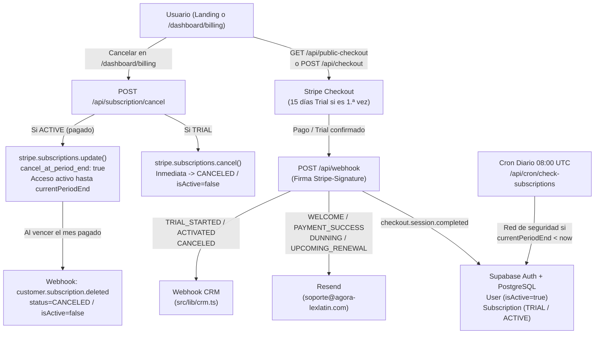

# 04 — Integración con Stripe y Ciclo de Vida de Suscripciones (Ágora Plus)

> **Última actualización:** `2026-11-23` (`v5.11.9`)  
> **Entorno de Producción:** `https://www.agora-lexlatin.com`  
> **Versión de API Stripe:** `2026-05-27.dahlia` ([`src/lib/stripe.ts`](../src/lib/stripe.ts))  
> **Endpoint de Webhooks:** `POST https://www.agora-lexlatin.com/api/webhook`

---

## 1. Arquitectura General del Ciclo de Suscripción

Toda la gestión de cobros, pruebas gratuitas, renovaciones y cancelaciones de **Ágora Plus** está desacoplada mediante **Stripe Checkout + Stripe Webhooks + Prisma (Supabase PostgreSQL) + Resend + Cron diario de respaldo**.



---

## 2. Variables de Entorno y Configuración Requerida

### 2.1 Variables en Vercel (Production)
| Variable | Propósito | Notas Críticas |
| :--- | :--- | :--- |
| `STRIPE_SECRET_KEY` | Llave secreta de Stripe (`sk_live_...` o `rk_live_...`) | **CRÍTICO:** En producción debe ser llave **Live**. Si se usa una *Restricted Key* (`rk_live_...`), debe tener permiso **Write** en `Customers`, `Subscriptions`, `Checkout Sessions` y `Billing Portal Sessions`. En local (`.env.local`) suele existir una llave `test` (`sk_test_...`). |
| `STRIPE_WEBHOOK_SECRET` | Secreto de firma (`whsec_...`) del endpoint de webhooks | Usado en `stripe.webhooks.constructEvent()` para validar el header `Stripe-Signature`. Si no coincide, el webhook responde `400`. |
| `STRIPE_PRICE_ID` | ID del precio mensual recurrente en Stripe (`price_...`) | Usado en `/api/checkout` y `/api/public-checkout`. |
| `NEXT_PUBLIC_SITE_URL` | URL base canónica (`https://www.agora-lexlatin.com`) | Construye `success_url`, `cancel_url`, `return_url` y enlaces en correos. |
| `RESEND_API_KEY` | Llave de Resend para correos transaccionales | Remitente: `soporte@agora-lexlatin.com`. |
| `CRON_SECRET` | Token Bearer para autorizar los crons de Vercel | Usado en `/api/cron/check-subscriptions`. |

### 2.2 Eventos Suscritos en Stripe Dashboard (Live)
El webhook `https://www.agora-lexlatin.com/api/webhook` procesa exactamente los siguientes **8 eventos**:
1. `checkout.session.completed`
2. `customer.subscription.trial_will_end`
3. `customer.subscription.created`
4. `customer.subscription.updated`
5. `customer.subscription.deleted`
6. `invoice.payment_succeeded`
7. `invoice.paid`
8. `invoice.payment_failed`
9. `invoice.upcoming`

---

## 3. Modelo de Datos (Prisma / PostgreSQL)

Definido en [`prisma/schema.prisma`](../prisma/schema.prisma):

* **`User`**:
  * `stripeCustomerId` (`String? @unique`): Vincula el usuario de Ágora con su `cus_...` en Stripe.
  * `isActive` (`Boolean @default(true)`): Interruptor maestro de acceso. Si es `false`, bloquea inmediatamente el ingreso al Dashboard y redirige a `/deactivated`.
  * `role` (`USER | ADMIN | SUPERADMIN`): Los roles `ADMIN` y `SUPERADMIN` omiten todas las validaciones de suscripción.
  * `parentId` (`String?`): Para cuentas corporativas (hijos), el estado de suscripción y `isActive` se hereda del usuario padre (`parent`).
* **`Subscription`**:
  * `stripeSubscriptionId` (`String? @unique`): ID `sub_...` en Stripe (`null` para acuerdos manuales/corporativos legados).
  * `status` (`SubscriptionStatus`): `TRIAL` | `ACTIVE` | `CANCELED` | `PAST_DUE` | `INCOMPLETE`.
  * `trialEndsAt` (`DateTime?`): Fin del periodo de prueba de 15 días. Sirve además como historial para evitar múltiples pruebas gratuitas con el mismo correo.
  * `trialReminderSentAt` (`DateTime?`): Marca de idempotencia del recordatorio de fin de trial enviado por cron.
  * `currentPeriodEnd` (`DateTime?`): Fecha/hora UTC exacta en la que concluye el ciclo de facturación pagado actual.
  * `cancelAtPeriodEnd` (`Boolean @default(false)`): Cuando es `true` con `status = 'ACTIVE'`, indica que el usuario canceló la renovación automática pero **conserva acceso completo hasta `currentPeriodEnd`**.

---

## 4. Reglas de Negocio por Endpoint

### 4.1 Inicio de Checkout (`GET /api/public-checkout` y `POST /api/checkout`)
* Archivos: [`src/app/api/public-checkout/route.ts`](../src/app/api/public-checkout/route.ts) y [`src/app/api/checkout/route.ts`](../src/app/api/checkout/route.ts).
* **Regla Anti-Abuso de Prueba Gratuita (15 días una sola vez):**
  * Si el usuario ya registra `trialEndsAt !== null`, `status === 'CANCELED'` o `status === 'ACTIVE'` (o se pasa `?noTrial=true`), `subscription_data` se envía vacío `{}` → **cobro inmediato sin días gratis**.
  * Solo si es un cliente nuevo sin historial de trial se envía `subscription_data: { trial_period_days: 15 }`.
* **Reutilización de `stripeCustomerId`:** Si el correo ya existe con `stripeCustomerId`, se pasa `customer: stripeCustomerId` para evitar clientes duplicados en Stripe.

### 4.2 Portal de Autogestión (`POST /api/portal`)
* Archivo: [`src/app/api/portal/route.ts`](../src/app/api/portal/route.ts).
* Crea una sesión de `stripe.billingPortal.sessions.create` para que el cliente pueda actualizar su tarjeta, descargar facturas o reactivar una suscripción con `cancel_at_period_end: true`.
* Retorna siempre a `${baseUrl}/dashboard/billing`.

### 4.3 Cancelación de Suscripción (`POST /api/subscription/cancel`) — Regla Diferenciada (`v5.11.7` / `v5.11.9`)
* Archivo: [`src/app/api/subscription/cancel/route.ts`](../src/app/api/subscription/cancel/route.ts) + UI en [`src/app/dashboard/billing/CancelSubscriptionModal.tsx`](../src/app/dashboard/billing/CancelSubscriptionModal.tsx) y [`src/app/dashboard/billing/page.tsx`](../src/app/dashboard/billing/page.tsx).

| Escenario | Detección | Acción en Stripe | Estado en Prisma | Comportamiento en UI | Correo Enviado |
| :--- | :--- | :--- | :--- | :--- | :--- |
| **Prueba Gratuita (`TRIAL`)** | `status === 'TRIAL'` o `trialEndsAt > now` | `stripe.subscriptions.cancel(subId)` (**inmediata**) | `status: 'CANCELED'`, `cancelAtPeriodEnd: false`, `user.isActive: false` | Redirige a `/deactivated` | `TRIAL_CANCELLED` (garantía de cero cargos) |
| **Suscripción Pagada (`ACTIVE`)** | `!isTrial` y `status === 'ACTIVE'` | `stripe.subscriptions.update(subId, { cancel_at_period_end: true })` (**diferida al fin de ciclo**) | `status: 'ACTIVE'`, `cancelAtPeriodEnd: true`, `currentPeriodEnd` sincronizado, `user.isActive: true` | Cierra modal y ejecuta `router.refresh()` mostrando banner ámbar con fecha fin de acceso | `SUBSCRIPTION_CANCELLED` (confirma cero cobros futuros y acceso hasta `currentPeriodEnd`) |

* **Regla de Cero Fallos Silenciosos (`v5.11.9`):**
  * Si la llamada a Stripe falla por cualquier motivo distinto a que la suscripción ya no exista o ya esté cancelada (`resource_missing` / `already canceled`), el endpoint **NO actualiza Prisma** y devuelve `HTTP 502` con mensaje explícito. Esto impide que Ágora marque una cuenta como cancelada mientras Stripe sigue cobrándola.
* **Compatibilidad con Stripe API `2025+` (`current_period_end`):**
  * Se extrae `current_period_end` leyendo primero `sub.current_period_end` y, como fallback, `sub.items?.data?.[0]?.current_period_end`.

### 4.4 Procesamiento de Webhooks (`POST /api/webhook`)
* Archivo: [`src/app/api/webhook/route.ts`](../src/app/api/webhook/route.ts).

| Evento Stripe | Acción Principal en BD / Servicios |
| :--- | :--- |
| `checkout.session.completed` | Crea el usuario en Supabase Auth (`generateLink({ type: 'invite' })` o `magiclink` si ya existía), crea/actualiza `User` (`isActive: true`) y `Subscription` (`TRIAL` o `ACTIVE`), envía correo `WELCOME` con enlace de acceso y notifica al CRM (`TRIAL_STARTED` o `SUBSCRIPTION_ACTIVATED`). |
| `customer.subscription.trial_will_end` | Envía correo `REMINDER_TRIAL` y notifica `TRIAL_EXPIRING` al CRM. |
| `customer.subscription.created` / `updated` / `deleted` | Mapea estado Stripe (`trialing`→`TRIAL`, `active`→`ACTIVE`, `canceled`→`CANCELED`, `past_due`/`unpaid`→`PAST_DUE`), actualiza `currentPeriodEnd` y `cancelAtPeriodEnd`. Si `newStatus === CANCELED`, desactiva `user.isActive = false`, notifica al CRM y envía `TRIAL_CANCELLED` si venía de trial. Si `ACTIVE`/`TRIAL`, asegura `user.isActive = true`. Si `PAST_DUE`, envía `DUNNING`. |
| `invoice.payment_succeeded` / `invoice.paid` | Marca `status: 'ACTIVE'`, `cancelAtPeriodEnd: false`. Si `amount_paid > 0`, envía correo `PAYMENT_SUCCESS`. |
| `invoice.payment_failed` | Marca `status: 'PAST_DUE'` y envía correo `DUNNING` (el `DunningBanner` rojo aparece en el Dashboard). |
| `invoice.upcoming` (**Blindado en `v5.11.9`**) | **Antes de enviar `UPCOMING_RENEWAL`**, consulta `subscription` en BD. Si `status === 'CANCELED'`, `cancelAtPeriodEnd === true` o `amount_due <= 0`, **suprime el correo** y ejecuta **auto-sanación (`self-heal`)** llamando `stripe.subscriptions.update(subId, { cancel_at_period_end: true })`. |

### 4.5 Cron Diario de Respaldo (`GET /api/cron/check-subscriptions`)
* Archivo: [`src/app/api/cron/check-subscriptions/route.ts`](../src/app/api/cron/check-subscriptions/route.ts) · Programación en [`vercel.json`](../vercel.json): `0 8 * * *` (todos los días a las 08:00 UTC).
* Ejecuta **3 bloques**:
  1. **Trials por vencer (`status: 'TRIAL'`):** Envía recordatorio `REMINDER_TRIAL` cuando faltan ≤ 3 días (si `trialReminderSentAt` es nulo) y desactiva (`isActive: false`, `status: 'PAST_DUE'`) si `trialEndsAt < today`.
  2. **Acuerdos Manuales / Corporativos (`stripeSubscriptionId: null`):** Envía avisos a 3, 2, 1 y 0 días del vencimiento y desactiva al día siguiente.
  3. **Red de Seguridad para Cancelaciones Diferidas (`v5.11.7`):** Busca cuentas con `isActive: true`, `status: 'ACTIVE'`, `cancelAtPeriodEnd: true` y `currentPeriodEnd < now`. Si algún webhook `customer.subscription.deleted` de Stripe se perdió (o la suscripción fue restaurada manualmente en BD), las desactiva automáticamente (`isActive: false`, `status: 'CANCELED'`).

---

## 5. Reglas de Control de Acceso en Tiempo Real

Evaluadas en [`src/app/dashboard/layout.tsx`](../src/app/dashboard/layout.tsx#L45-L92) y [`src/app/(auth)/login/actions.ts`](../src/app/(auth)/login/actions.ts#L52-L64) para todo usuario cuyo rol **no** sea `ADMIN` ni `SUPERADMIN`:

1. `dbUser.isActive === false` → redirige a `/deactivated`.
2. Si es usuario hijo (`parentId !== null`), hereda `parent.isActive` y `parent.subscription`. Si el padre está inactivo → `/deactivated`.
3. Sin registro en `Subscription` (`!effectiveSub`) → `/deactivated`.
4. `effectiveSub.status === 'CANCELED'` → `/deactivated`.
5. `effectiveSub.status === 'INCOMPLETE'` → `/deactivated`.
6. `effectiveSub.status === 'TRIAL'` con `trialEndsAt < now` → `/deactivated`.
7. **`effectiveSub.status === 'ACTIVE'` con `cancelAtPeriodEnd === true` y `currentPeriodEnd < now`** → `/deactivated` (cierre exacto al vencer el mes pagado, incluso antes de que corra el cron de las 08:00 UTC).

*(Nota: Si `status === 'PAST_DUE'`, el usuario puede entrar momentáneamente para ver el `DunningBanner` rojo y actualizar su tarjeta en `/dashboard/billing`).*

---

## 6. Catálogo de Plantillas de Correo Relacionadas (Resend)

Gestionables desde `/dashboard/admin/smtp` (tabla `EmailTemplate`):
* `WELCOME` — Bienvenida y enlace de activación (`checkout.session.completed`).
* `REMINDER_TRIAL` — Recordatorio 3 días antes del fin de prueba (`trial_will_end` y cron diario).
* `TRIAL_CANCELLED` — Confirmación de cancelación sin cargos durante el trial (`/api/subscription/cancel` y webhook).
* `SUBSCRIPTION_CANCELLED` — Confirmación de cancelación de renovación en suscripción pagada (soporta `{{periodEndDate}}`).
* `PAYMENT_SUCCESS` — Confirmación de cobro mensual exitoso (`invoice.payment_succeeded` con `amount_paid > 0`).
* `DUNNING` — Aviso de fallo de cobro / tarjeta rechazada (`invoice.payment_failed` y `status: PAST_DUE`).
* `UPCOMING_RENEWAL` — Aviso previo de renovación automática (`invoice.upcoming`, solo si está activa y sin baja programada).

---

## 7. Playbook de Troubleshooting y Mantenimiento

### Caso A: Usuario dice que canceló pero le llegó correo de renovación (`UPCOMING_RENEWAL`)
1. Verificar estado del usuario en PostgreSQL:
   ```bash
   cd agora-plus && NODE_OPTIONS="--experimental-websocket" npx tsx --env-file=.env.local -e '
   import prisma from "./src/lib/prisma";
   async function main() {
     const u = await prisma.user.findUnique({ where: { email: "correo@ejemplo.com" }, include: { subscription: true } });
     console.log(JSON.stringify(u, null, 2));
     process.exit(0);
   }
   main();
   '
   ```
2. Entrar a **Stripe Live Dashboard** → **Suscripciones** → buscar el correo o `stripeSubscriptionId` (`sub_...`).
3. Verificar que el estado diga **`Cancela el <fecha>`** (y **NO** `Activa` con cobro automático). Si aparece `Activa`, hacer clic en **Acciones → Cancelar suscripción → Final del período actual**.
4. Revisar logs de Vercel para `[STRIPE_CANCEL_AT_PERIOD_END_ERROR]` y confirmar que `STRIPE_SECRET_KEY` en Vercel Production tenga permisos de escritura sobre `Subscriptions`.

### Caso B: Error `No such customer: 'cus_...'` al correr scripts locales
* **Causa:** `.env.local` suele tener la llave `sk_test_...` de Stripe (modo pruebas), mientras que la base de datos de producción almacena `cus_...` y `sub_...` del modo **Live**.
* **Solución:** No ejecutar mutaciones de Stripe Live desde `.env.local` con llave test; usar el Dashboard de Stripe Live o un entorno con la llave correspondiente.

### Caso C: Restaurar acceso a un usuario pagado hasta fin de su periodo
Si por alguna razón un usuario pagado fue desactivado antes de `currentPeriodEnd` y su suscripción ya está cancelada/programada en Stripe:
```bash
cd agora-plus && NODE_OPTIONS="--experimental-websocket" npx tsx --env-file=.env.local -e '
import prisma from "./src/lib/prisma";
async function main() {
  const email = "correo@ejemplo.com";
  const u = await prisma.user.findUnique({ where: { email } });
  if (!u) throw new Error("No encontrado");
  await prisma.user.update({ where: { id: u.id }, data: { isActive: true } });
  await prisma.subscription.update({ where: { userId: u.id }, data: { status: "ACTIVE", cancelAtPeriodEnd: true } });
  console.log("Acceso restaurado hasta currentPeriodEnd");
  process.exit(0);
}
main();
'
```
El acceso expirará automáticamente al alcanzarse `currentPeriodEnd` (tanto en tiempo real por `DashboardLayout` como por el webhook de Stripe / cron diario).
